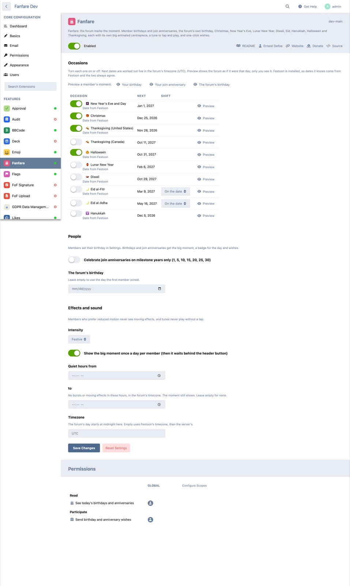

# Fanfare

 [](https://packagist.org/packages/ernestdefoe/fanfare)

A [Flarum 2](https://flarum.org) extension that makes your forum mark the moment. On a member's birthday a big layered cake rises onto their screen with the candles lighting one by one and "Happy Birthday" piped on it. On Christmas a wrapped present arrives with a gift tag from your forum and twinkling lights across the top. Each occasion has its own centrepiece, a tune to tap and play, and effects behind it.


## What it celebrates

| Occasion | The moment |
| --- | --- |
| A member's birthday | A three-tier cake rises, the candles light, confetti falls. Tap a candle or **Make a wish** to blow them out. |
| A member's join anniversary, every year | A medal with the number of years and a star for each, and a fanfare. |
| The forum's own birthday | A gold number balloon with a bunch of balloons, bunting across the top and the forum's numbers. |
| New Year's Eve and Day | A gold clock counts down to each member's own midnight, then strikes twelve into fireworks. |
| Christmas | A wrapped present with a swinging gift tag ("To: you, From: your forum"), string lights and snow. Tap it to open it. |
| Hanukkah | A menorah lit for the night: the shamash first, then the newest candle. |
| Lunar New Year | A silk lantern drops in and strings of firecrackers pop. |
| Diwali | A rangoli blooms and a row of diyas lights up. |
| Eid al-Fitr and Eid al-Adha | A gold crescent with lanterns that light in turn. |
| Halloween | A carved pumpkin lights up and bats fly out. |
| Thanksgiving (US and Canada) | An autumn leaf wreath, with leaves falling. |

The US holidays are on when you install it; the world holidays are a switch away in the settings.

Everyone also sees **Today's birthdays** and anniversaries in the sidebar (a strip of chips on phones) with a one-tap **Wish**, which sends a notification. Members get a badge for their day on their posts and profile.


## Gentle by design

- **The moment shows once a day per member**, then waits behind a button in the header.
- **Nothing ever plays by itself.** Tunes play when the member taps ♪ Play, and turning sound off is remembered on every device.
- **Members who prefer reduced motion** get the centrepiece standing still, already lit, with no confetti.
- **Skippable**: Close or Esc, any time.
- **Light on normal days**: forum.js is about 5 KB gzipped. The centrepieces, effects and tunes (about 22 KB gzipped) are one script added only on a day with a moment. The two display fonts ship with the extension, so no font service is called.

## Birthdays and privacy

Members set their birthday in **Settings → Fanfare**: month and day, with the year optional (only needed to show an age). They choose who sees it: nobody (they still get their own greeting), the day, or the day and their age.

If [Birthdays by datlechin](https://github.com/datlechin/flarum-birthdays) is installed, Fanfare uses its birthday field and its privacy choices instead.

## With Festoon

If [Festoon](https://github.com/ernestdefoe/festoon) is installed, Fanfare takes holiday dates from it, so the two always agree. Festoon's falling snow or leaves keep falling and Fanfare doesn't add its own. A member who turned Festoon's decorations off doesn't get Fanfare's effects either.

## Settings



Admin → Fanfare:

- Each occasion on or off, with its next date, a preview, and for moon-sighted holidays (the two Eids) a shift of a day either way.
- Join anniversaries every year, or milestone years only.
- The forum's birthday (by default, the day the first member joined).
- Intensity (subtle, festive, full), once a day per member, quiet hours, and the timezone the forum's day starts in.

Admins can preview any moment with `?fanfare=<id>` on the forum, for example `?fanfare=christmas` or `?fanfare=birthday`. Only admins see a preview.

## Permissions

| Permission | Default | Allows |
| --- | --- | --- |
| See today's birthdays and anniversaries | Members | The widget, the badges and the list. |
| Send birthday and anniversary wishes | Members | The Wish button. One wish per person, occasion and year. |

## Install

```sh
composer require ernestdefoe/fanfare
php flarum migrate
php flarum cache:clear
```

The anniversary and birthday greetings in the notification bell are sent by Flarum's scheduler, so set up its cron entry ([docs](https://docs.flarum.org/2.x/scheduler)).

## Update

```sh
composer update ernestdefoe/fanfare
php flarum migrate
php flarum cache:clear
```

## Credits

The display fonts Pacifico (the Pacifico Project Authors) and Creepster (Font Diner, Inc) are licensed under the SIL Open Font License 1.1; the licences are in `assets/fonts/`.

## Links

- [Packagist](https://packagist.org/packages/ernestdefoe/fanfare)
- [GitHub](https://github.com/ernestdefoe/fanfare)
- ☕ [Buy me a coffee](https://buymeacoffee.com/ernestdefoe)
